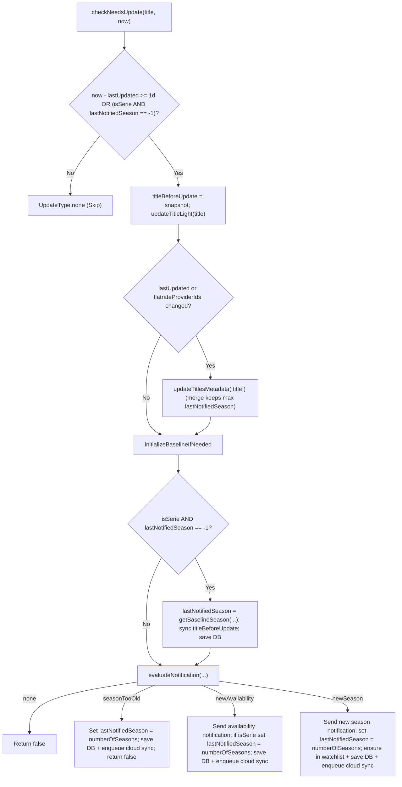
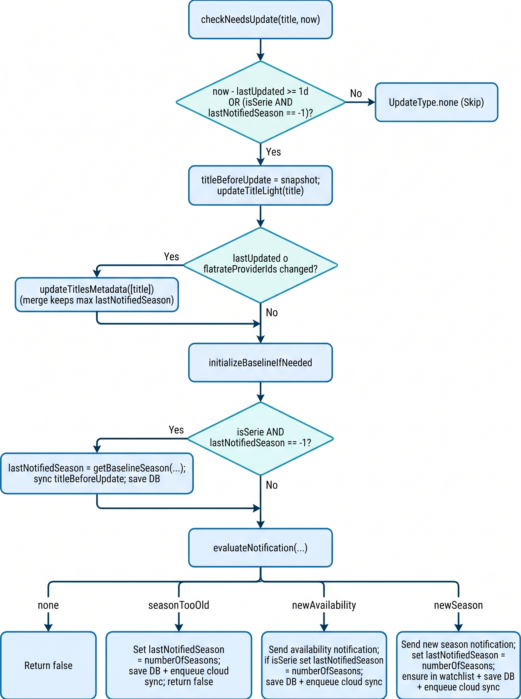
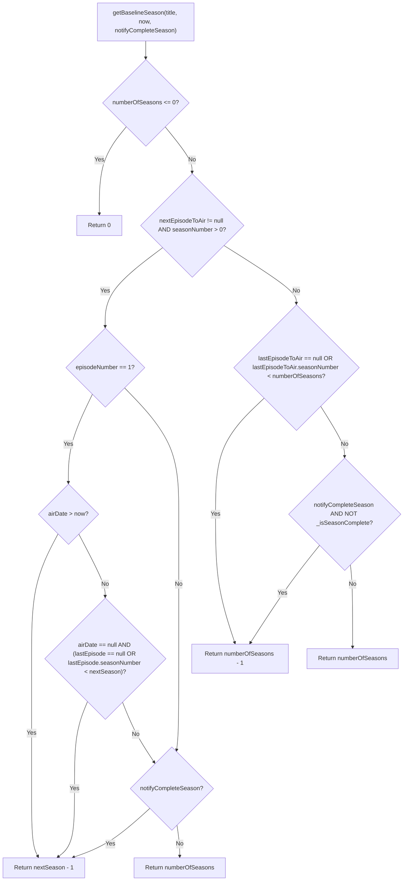
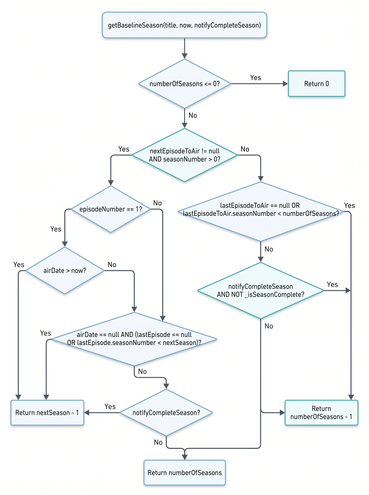
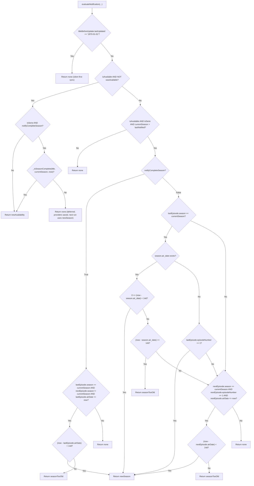
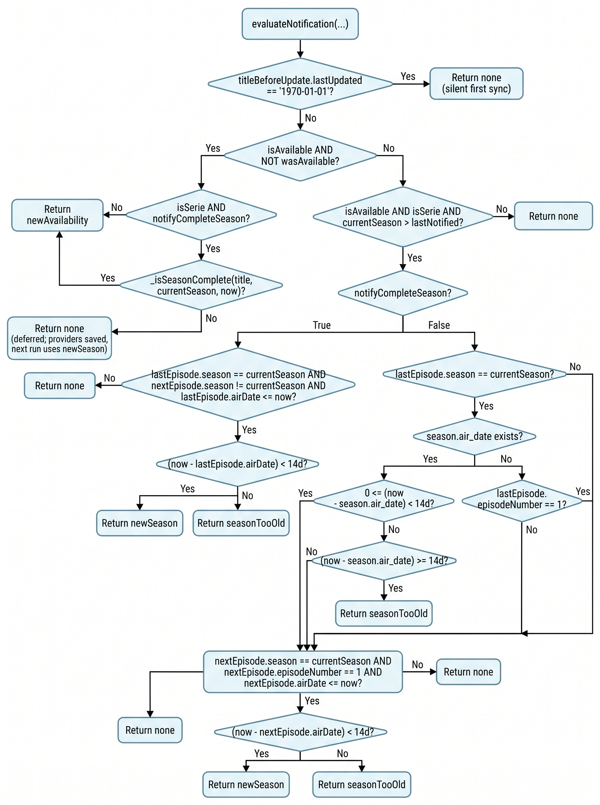

# Watchlist & New Season Notifications

Reference diagrams for [watchlist_update_service.dart](lib/features/watchlist/services/watchlist_update_service.dart) and [watchlist_notification_evaluator.dart](lib/features/notifications/services/watchlist_notification_evaluator.dart).

## State Variables

| Variable | Values | Role |
| :--- | :--- | :--- |
| `lastNotifiedSeason` | `-1` (`seasonNotInitialized`) | Baseline never computed yet (also mapped from Supabase `<= 0` on fetch) |
| | `0` | Baseline computed as `0` (waiting for S1 to premiere or complete) |
| | `N >= 1` | Season `N` already baselined or notified |
| `lastUpdated` | `'1970-01-01'` (`defaultDate`) | Never synced from TMDB yet (`evaluateNotification` returns `none`) |
| | ISO timestamp | Synced on this date; scanned once per `watchlistProvidersUpdateFrequencyDays` (1 day) |
| `wasAvailable` / `isAvailable` | `bool` | Intersection of `flatrateProviderIds` (before/after TMDB update) with `enabledProviderIds` |
| `notifyCompleteSeason` | `bool` (preference) | Wait until a season finishes airing before notifying |
| `watchlistNewSeasonNotificationWindowDays` | `14` days | Max age since premiere (or finale when `notifyCompleteSeason = true`) to trigger `newSeason` |

---

## 1. Per-Title Update Flow (`_updateTitle`)

---

## 2. Baseline Calculation (`getBaselineSeason`)

Runs **once** when `lastNotifiedSeason == -1` (`AppConstants.seasonNotInitialized`).

---

## 3. Notification Evaluation (`evaluateNotification`)

---

## Key Behavioral Notes

- **Deferred `newAvailability` with `notifyCompleteSeason = true`:** When an incomplete season becomes available on a provider, `flatrateProviderIds` is persisted on the first run. Once the last episode airs, `wasAvailable` is already `true`, so it fires as `newSeason` ("New season") provided `currentSeason > lastNotifiedSeason` (the 14-day window only starts from that finale date).
- **Cloud sync (`CloudTitleRepository`):** Local `-1` (`seasonNotInitialized`) is clamped to `0` (`math.max(0, lastNotifiedSeason)`) on write, and remote values `<= 0` are mapped back to `-1` on initial fetch.

---

## 4. User Use Cases (When Do You Get Notified?)

### Movies

- **Not available → available** on any of your enabled platforms → **Notifies** (*Now available*).
- Already available, not available, or removed → **Does not notify**.

### TV Series

| Real-World Situation | `notifyCompleteSeason = false` | `notifyCompleteSeason = true` |
| :--- | :--- | :--- |
| **1. You add a series NOT yet on your platforms**, and later it arrives on one | **Notifies** (*Now available*) as soon as it arrives | **Notifies** (*Now available*) if already complete; if still airing, defers and **notifies** (*New season*) once the season finishes |
| **2. You add a series ALREADY on your platforms whose current season already started/ended** | **Does not notify** on add (baseline set to `numberOfSeasons`) | **Does not notify** if finished; if still airing, baseline is `numberOfSeasons - 1` so it **notifies** when finished |
| **3. You add an unreleased series ALREADY listed on a platform** | Baseline stays `0`; **notifies** (*New season*) when S1 premieres | Baseline stays `0`; **notifies** (*New season*) when S1 finishes |
| **4. A followed/watchlist series on your platforms gets a new season** | **Notifies** (*New season*) when it premieres | **Notifies** (*New season*) when the last episode airs |
| **5. A new season premiered (or finished, if `notifyCompleteSeason = true`) `>= 14` days ago** (missed sync or late TMDB update) | **Does not notify** and marks `lastNotifiedSeason = currentSeason` | **Does not notify** and marks `lastNotifiedSeason = currentSeason` |
| **6. A new season airs, but the series is NOT on your platforms** | **Does not notify** (will notify via Case 1 if the series later arrives on your platforms) | **Does not notify** (will notify via Case 1 if the series later arrives complete on your platforms) |

